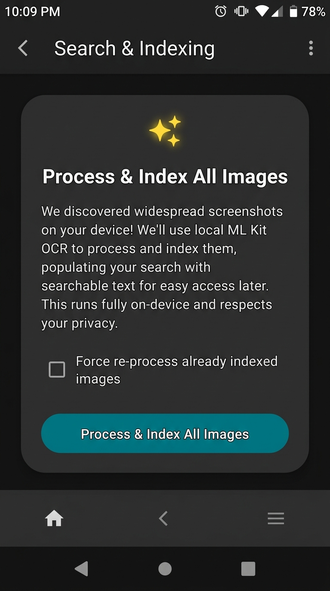
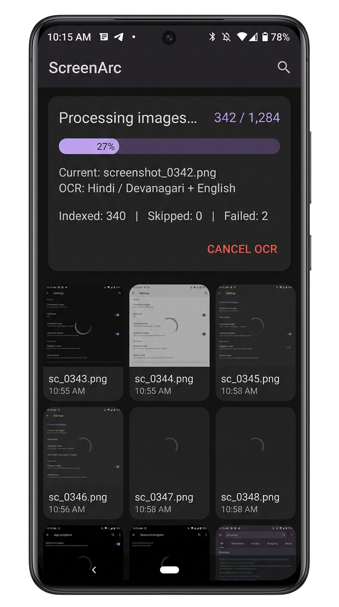
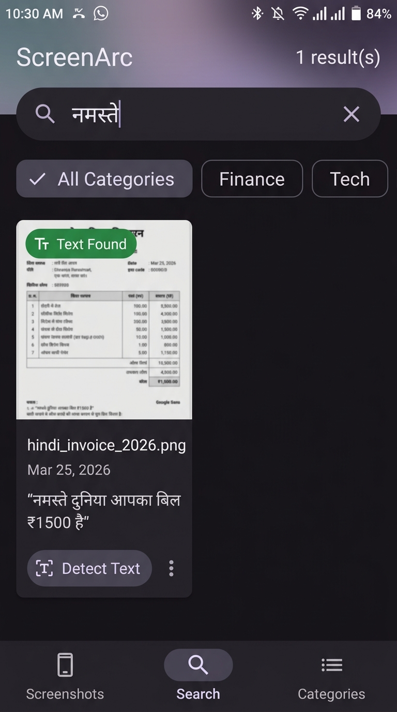

# ScreenArc (Screenshot Sorter & Multilingual OCR)

ScreenArc is an intelligent, privacy-focused Android application designed to automatically detect, organize, OCR-index, and search screenshots seamlessly using an adaptive floating overlay service, Google ML Kit on-device Text Recognition, and Jetpack Compose.

---

## 📸 Screenshots & Walkthrough

| Main Interface | OCR Settings & Languages | Process & Index All Images |
| :---: | :---: | :---: |
|  |  |  |

| Live Batch OCR Progress | Native-Language Search |
| :---: | :---: |
|  |  |

---

## ✨ Features

### 1. 🌐 Multilingual On-Device OCR (Devanagari & Latin Scripts)
- **Indian Native-Language Script Support:** Full on-device text recognition for **Devanagari script** (Hindi, Marathi, Sanskrit, Nepali, Konkani, Bodo, Dogri, Maithili, etc.) using Google ML Kit's specialized Devanagari recognition model.
- **Bilingual & Mixed-Language Support:** Recognizes images containing both Devanagari script and English/Latin characters concurrently in a single pass.
- **100% On-Device Privacy:** Zero cloud dependencies, zero data leakage, and full offline operation.
- **Bounded Concurrency & Thermal Safety:** Controlled via `Semaphore(2)` on `Dispatchers.IO` to maintain CPU and thermal efficiency without UI stutter.

### 2. ⚡ Extensible Multi-Model OCR Engine Architecture
- **Pluggable OCR Engine Abstraction:** Clean abstraction layer (`OcrEngineProvider`) decoupling the recognition engine and model selection from database indexing and search.
- **Configurable Language Selector:** Intuitive UI in Settings to switch between active recognition models (`Hindi / Devanagari + English` vs `English / Latin`).
- **Lifecycle & Model Reuse Optimization:** In batch processing, models are instantiated once and reused across all images, avoiding expensive per-image model reload cycles.

### 3. 🚀 "Process & Index All Images" (Bulk Indexing)
- **Complete Storage Discovery:** Queries and syncs all screenshots from Android MediaStore into the local database without artificial limits.
- **Intelligent Processing:** Automatically identifies unindexed or failed screenshots while skipping already-indexed unchanged screenshots (with an optional force re-index toggle).
- **Non-Blocking Background Execution:** Powered by Kotlin Coroutines and StateFlow; operations never freeze the UI.
- **Live Interactive Progress UI:**
  - Real-time progress bar with current count / total count (`342 / 1,284`).
  - Active file indicator (`Current: screenshot_0342.png`).
  - Active recognition model (`OCR: Hindi / Devanagari + English`).
  - Live counters (`Indexed: 340 | Skipped: 0 | Failed: 2`).
  - Graceful cancellation (`[ Cancel OCR ]`).
- **Resilient Error Isolation:** Corrupted images, missing files, or out-of-memory errors on individual items are recorded with specific error messages without terminating the batch.

### 4. 🔍 Unicode-Safe Search Pipeline
- **Unicode NFKC Normalization:** Extracted text and user search queries are normalized via Unicode Form NFKC (Compatibility Decomposition followed by Canonical Composition) and case-folded safely (`Locale.ROOT`).
- **Combining Character & Diacritic Safety:** Resolves decomposed vs precomposed Unicode character discrepancies across Indian scripts.
- **Multi-Field Instant Search:** Search screenshots by filename, OCR-recognized text (Devanagari, Latin, etc.), category, and OCR status with 300ms debounced reactive queries.

### 5. 🎯 Adaptive Floating Radial Arc & Drag-and-Drop Sorter
- **Radial Arc Menu:** Responsive circular drop targets for up to 8 categories with spring physics.
- **Paginated Drop Tray:** Automatically switches to a multi-column tray for larger category collections (> 8).
- **Dynamic Palette Theming:** Extracts palette colors from screenshot thumbnails to tint hovered chips.
- **Haptic Feedback:** Tactile snap and drop confirmation.

### 6. 📄 OCR Visual Overlay & Text Dialog
- **Bounding Box Viewer:** Visual overlay renderer displaying recognized text boxes over screenshot previews.
- **One-Tap Actions:** Quick copy to clipboard, share text, and single-tap manual re-index.

---

## 🏗️ Architecture & Pipeline

```text
┌─────────────────────────────────────────────────────────────────────────┐
│                           ScreenArc Pipeline                            │
└─────────────────────────────────────────────────────────────────────────┘
                                   │
                           [ Screenshot Image ]
                                   │
                                   ▼
                        ┌─────────────────────┐
                        │  OcrEngineProvider  │
                        │ (MlKitOcrProvider)  │
                        └─────────────────────┘
                                   │
            ┌──────────────────────┴──────────────────────┐
            ▼                                             ▼
  [ Devanagari + Latin Model ]                  [ Latin Only Model ]
  (Hindi, Marathi, Sanskrit, English)           (English, Western European)
            │                                             │
            └──────────────────────┬──────────────────────┘
                                   │
                                   ▼
                        ┌─────────────────────┐
                        │   Raw OCR Result    │
                        │ (Text + Bounding)   │
                        └─────────────────────┘
                                   │
                                   ▼
                        ┌─────────────────────┐
                        │  Unicode NFKC &     │
                        │ Text Normalization  │
                        └─────────────────────┘
                                   │
                                   ▼
                        ┌─────────────────────┐
                        │    AppDatabase      │
                        │ (Room: ocr_texts)   │
                        └─────────────────────┘
                                   │
                                   ▼
                        ┌─────────────────────┐
                        │  Debounced Search   │
                        │ (SearchViewModel)   │
                        └─────────────────────┘
                                   │
                                   ▼
                        ┌─────────────────────┐
                        │ Jetpack Compose UI  │
                        └─────────────────────┘
```

---

## 📊 Supported OCR Languages & Models

| Language Family | Script | OCR Status | Model Library | Notes |
| :--- | :--- | :--- | :--- | :--- |
| **Hindi / Marathi / Sanskrit / Nepali / Konkani** | Devanagari | **Supported (Bundled)** | `com.google.mlkit:text-recognition-devanagari` | **Recommended Default.** Full Devanagari recognition + bilingual English Latin recognition in a single model. |
| **English / Latin** | Latin | **Supported (Bundled)** | `com.google.mlkit:text-recognition` | Default Latin recognizer optimized for English and European Latin text. |
| **Tamil** | Tamil | Extensible Provider | Custom Provider / Tesseract | Script not yet bundled in on-device ML Kit v2; extensible via `OcrEngineProvider` interface. |
| **Telugu** | Telugu | Extensible Provider | Custom Provider / Tesseract | Script not yet bundled in on-device ML Kit v2; extensible via `OcrEngineProvider` interface. |
| **Kannada** | Kannada | Extensible Provider | Custom Provider / Tesseract | Script not yet bundled in on-device ML Kit v2; extensible via `OcrEngineProvider` interface. |
| **Malayalam** | Malayalam | Extensible Provider | Custom Provider / Tesseract | Script not yet bundled in on-device ML Kit v2; extensible via `OcrEngineProvider` interface. |
| **Bengali** | Bengali | Extensible Provider | Custom Provider / Tesseract | Script not yet bundled in on-device ML Kit v2; extensible via `OcrEngineProvider` interface. |
| **Chinese** | Chinese | Model-Ready | `text-recognition-chinese` | Pluggable into `OcrEngineProvider`. |
| **Japanese** | Japanese | Model-Ready | `text-recognition-japanese` | Pluggable into `OcrEngineProvider`. |
| **Korean** | Korean | Model-Ready | `text-recognition-korean` | Pluggable into `OcrEngineProvider`. |

---

## ⚙️ Technical Specifications & Details

### 1. OCR Engine & Model Installation
- **Engine:** Google ML Kit Text Recognition v2 (`16.0.1`).
- **Installation / Download:** Statically linked and bundled in the APK via Gradle dependencies:
  ```kotlin
  implementation("com.google.mlkit:text-recognition:16.0.1")
  implementation("com.google.mlkit:text-recognition-devanagari:16.0.1")
  ```
- **Storage Location:** On-device bundled native libraries and model weights packaged in the APK (`libmlkit_google_ocr_pipeline.so`).
- **Approximate Binary Size:** ~8.5 MB additional APK size for bundled Devanagari + Latin ML Kit models. Zero runtime downloads required.

### 2. Supported Image Formats
- PNG (`image/png`), JPEG (`image/jpeg`, `image/jpg`), WebP (`image/webp`), BMP (`image/bmp`), GIF (`image/gif`).
- Loaded via `InputImage.fromFilePath(context, uri)` with fallback to decoded input streams.

### 3. Bulk Indexing ("Process & Index All Images")
- **Discovery:** Scans `MediaStore.Images.Media` for screenshot paths across internal and external storage.
- **Smart Queueing:** Skips screenshots that already have `COMPLETED` or `NO_TEXT` status unless the user checks *"Force re-process already indexed images"*.
- **Throughput Optimization:** Instantiates a single `TextRecognizer` instance per batch, executing up to 2 parallel recognitions (`Semaphore(2)`), and cleans up resources in a `finally` block.
- **Cancellation:** Supports immediate user cancellation without leaving database records in an inconsistent state.

### 4. Unicode Normalization & Search Algorithm
Extracted text and search queries undergo identical normalization:
```kotlin
fun normalizeText(raw: String): String {
    if (raw.isBlank()) return ""
    val nfkcNormalized = Normalizer.normalize(raw, Normalizer.Form.NFKC)
    return nfkcNormalized
        .lowercase(Locale.ROOT)
        .replace(Regex("[\\r\\n]+"), " ")
        .replace(Regex("\\s{2,}"), " ")
        .trim()
}
```
Queries match against indexed tokens using SQLite `LIKE '%...%'` queries on normalized text fields.

### 5. Known Limitations
- **Indic Script Coverage in On-Device ML Kit:** Google ML Kit Text Recognition v2 currently provides bundled on-device models for Devanagari, Latin, Chinese, Japanese, and Korean. Southern Indic scripts (Tamil, Telugu, Kannada, Malayalam) and Bengali are not bundled in standard ML Kit v2 and are structured to be supported via pluggable custom `OcrEngineProvider` implementations.
- **Very Low Resolution Images:** Text with glyph height under 16 pixels may have reduced recognition accuracy.

---

## 🛠️ Tech Stack & Dependencies

- **Language:** Kotlin `2.0.21` (K2 compiler enabled)
- **Build System:** Gradle `8.7.2` + KSP `2.0.21-1.0.27`
- **UI:** Jetpack Compose (BOM `2024.10.01`), Material 3 `1.3.1`
- **Database:** Room `2.6.1` (KSP Room compiler, Coroutines KTX)
- **Machine Learning:** Google ML Kit Text Recognition `16.0.1` + Devanagari Model `16.0.1`
- **Async & Background:** Kotlinx Coroutines `1.9.0`, WorkManager `2.10.0`
- **Image Loading:** Coil Compose `2.7.0`, AndroidX Palette `1.0.0`
- **Testing:** JUnit `4.13.2`, JSON test suite

---

## 🚀 Building and Testing

```bash
# Run unit tests (including multilingual OCR, Unicode NFKC, and batch processing tests)
./gradlew testDebugUnitTest

# Build debug APK
./gradlew assembleDebug
```
