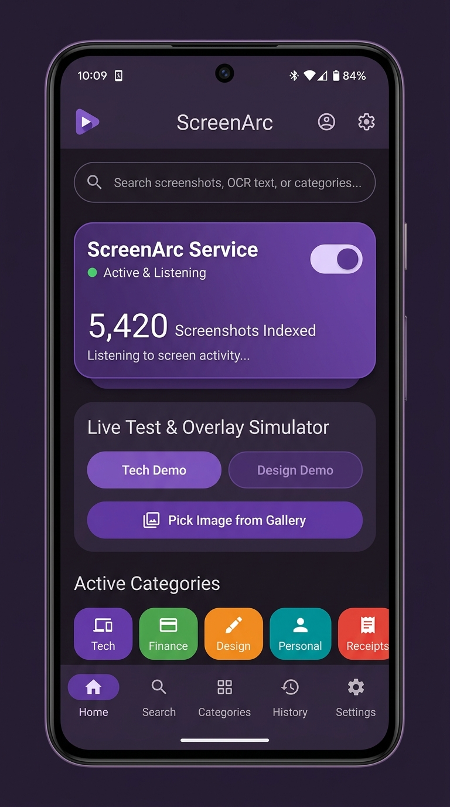
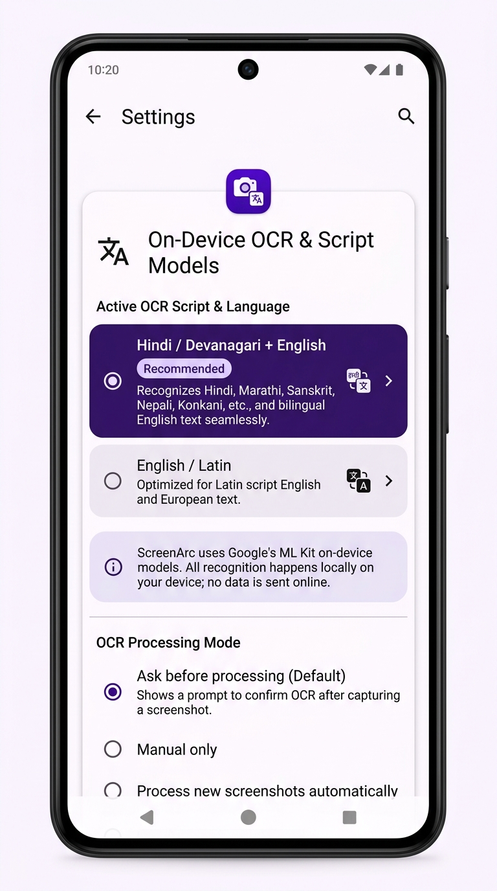

# ScreenArc (Screenshot Sorter & Multilingual OCR)

ScreenArc is an intelligent, privacy-focused Android application designed to automatically detect, organize, OCR-index, and search screenshots seamlessly using an adaptive floating overlay service, Google ML Kit on-device Text Recognition, automated keyword categorization rules, bulk management, and Jetpack Compose.
[](https://github.com/Arunkumar-Anbazhagan/ScreenArc/actions/workflows/build-apk.yml)
---

## 📸 Screenshots & Walkthrough

| Main Interface | OCR Settings & Languages | Process & Index All Images |
| :---: | :---: | :---: |
|  |  |  |

| Live Batch OCR Progress | Native-Language Search |
| :---: | :---: |
|  |  |

---

## ✨ Key Features

### 1. 📦 Multi-Select & Bulk Category Operations
- **Interactive Multi-Select Mode:** Easily select multiple screenshots with a dedicated selection toggle or long-press.
- **Bulk Move & Copy:** Move or copy dozens of screenshots to target categories in one tap, updating MediaStore, Room DB, and Organization History.
- **Bulk Actions Floating Bar:** Real-time counter of selected images, Select All / Deselect All, Bulk OCR, and Bulk Delete actions.

### 2. ⚡ Rules-Based Category Allocation
- **Automated Routing Rules:** Configure custom keyword rules in Settings to automatically allocate screenshots to specific categories when detected text or filenames match keywords:
  - e.g. Keyword matches `Movie`, `Netflix`, `IMDb`, `Cinema` ➔ **Movie** category
  - e.g. Keyword matches `Repo`, `Tool`, `OSINT`, `GitHub`, `Terminal` ➔ **Tech** category
  - e.g. Keyword matches `Receipt`, `Invoice`, `UPI`, `Billing` ➔ **Receipts** category
- **On-Demand Rule Execution:** Every rule features a dedicated **Play button** right beside it to trigger instant on-demand categorization for that specific rule.
- **"Run All Active Rules" Action:** One-tap header button to sequentially process all active rules.
- **Process Only New Screenshots:** Dedicated toggle on rules to process only unorganized/uncategorized screenshots, leaving already categorized images untouched.
- **Rule Lifecycle:** Enable/disable rules with switch toggles, create new rules with customizable target categories and keyword chips, edit, and delete rules.

### 3. 📜 Organized History with Rule Provenance
- **Rule Attribution Tracking:** History records store and display which exact rule executed the move (e.g. `⚡ Rule: Movie & Cinema` or `⚡ Rule: Tech, Repos & OSINT`).
- **Trigger Type Badges:** Differentiate between automated rule executions, bulk manual moves (`📦 Bulk Move`), and manual drag-and-drop sort actions.
- **Interactive Filter Chips:** Filter organized history instantly by `All`, `⚡ Rules Only`, `✋ Manual Only`, or specific target categories.
- **Detailed Preview Modal:** Fullscreen inspection with rule attribution banner, target folder paths, and instant Share / Open in gallery options.

### 4. 🌐 Multilingual On-Device OCR (Devanagari & Latin Scripts)
- **Indian Native-Language Script Support:** Full on-device text recognition for **Devanagari script** (Hindi, Marathi, Sanskrit, Nepali, Konkani, Bodo, Dogri, Maithili, etc.) using Google ML Kit's specialized Devanagari recognition model.
- **Bilingual & Mixed-Language Support:** Recognizes images containing both Devanagari script and English/Latin characters concurrently in a single pass.
- **100% On-Device Privacy:** Zero cloud dependencies, zero data leakage, and full offline operation.
- **Bounded Concurrency & Thermal Safety:** Controlled via `Semaphore(2)` on `Dispatchers.IO` to maintain CPU and thermal efficiency without UI stutter.

### 5. 🚀 "Process & Index All Images" (Bulk Indexing)
- **Complete Storage Discovery:** Queries and syncs all screenshots from Android MediaStore into the local database without artificial limits.
- **Intelligent Processing:** Automatically identifies unindexed or failed screenshots while skipping already-indexed unchanged screenshots (with an optional force re-index toggle).
- **Non-Blocking Background Execution:** Powered by Kotlin Coroutines and StateFlow; operations never freeze the UI.
- **Live Interactive Progress UI:**
  - Real-time progress bar with current count / total count (`342 / 1,284`).
  - Active file indicator (`Current: screenshot_0342.png`).
  - Active recognition model (`OCR: Hindi / Devanagari + English`).
  - Live counters (`Indexed: 340 | Skipped: 0 | Failed: 2`).
  - Graceful cancellation (`[ Cancel OCR ]`).

### 6. 🔍 Unicode-Safe Search Pipeline
- **Unicode NFKC Normalization:** Extracted text and user search queries are normalized via Unicode Form NFKC (Compatibility Decomposition followed by Canonical Composition) and case-folded safely (`Locale.ROOT`).
- **Multi-Field Instant Search:** Search screenshots by filename, OCR-recognized text (Devanagari, Latin, etc.), category, and OCR status with 300ms debounced reactive queries.

### 7. 🎯 Adaptive Floating Radial Arc & Drag-and-Drop Sorter
- **Radial Arc Menu:** Responsive circular drop targets for up to 8 categories with spring physics.
- **Paginated Drop Tray:** Automatically switches to a multi-column tray for larger category collections (> 8).
- **Dynamic Palette Theming:** Extracts palette colors from screenshot thumbnails to tint hovered chips.
- **Screenshot Detection Recovery:** Scans recent MediaStore images instead of assuming the newest image is a screenshot, retries captures that are still being written, and rescans/re-attaches the overlay when the app resumes after settings changes.

---

## 🏗️ Architecture & Pipeline

```text
┌─────────────────────────────────────────────────────────────────────────┐
│                           ScreenArc Pipeline                            │
└─────────────────────────────────────────────────────────────────────────┘
                                   │
                           [ Screenshot Image ]
                                   │
                                   ▼
                        ┌─────────────────────┐
                        │  OcrEngineProvider  │
                        │ (MlKitOcrProvider)  │
                        └─────────────────────┘
                                   │
            ┌──────────────────────┴──────────────────────┐
            ▼                                             ▼
  [ Devanagari + Latin Model ]                  [ Latin Only Model ]
  (Hindi, Marathi, Sanskrit, English)           (English, Western European)
            │                                             │
            └──────────────────────┬──────────────────────┘
                                   │
                                   ▼
                        ┌─────────────────────┐
                        │   Raw OCR Result    │
                        │ (Text + Bounding)   │
                        └─────────────────────┘
                                   │
                                   ▼
                        ┌─────────────────────┐
                        │  Unicode NFKC &     │
                        │ Text Normalization  │
                        └─────────────────────┘
                                   │
            ┌──────────────────────┴──────────────────────┐
            ▼                                             ▼
 ┌─────────────────────┐                       ┌─────────────────────┐
 │    AppDatabase      │                       │   RulesRepository   │
 │ (Room: ocr_texts)   │                       │ (Auto-Categorizer)  │
 └─────────────────────┘                       └─────────────────────┘
            │                                             │
            ▼                                             ▼
 ┌─────────────────────┐                       ┌─────────────────────┐
 │  Search & Bulk UI   │                       │ Organized History   │
 │ (SearchViewModel)   │                       │ (Rule Provenance)   │
 └─────────────────────┘                       └─────────────────────┘
```

---

## 📊 Supported OCR Languages & Models

| Language Family | Script | OCR Status | Model Library | Notes |
| :--- | :--- | :--- | :--- | :--- |
| **Hindi / Marathi / Sanskrit / Nepali / Konkani** | Devanagari | **Supported (Bundled)** | `com.google.mlkit:text-recognition-devanagari` | **Recommended Default.** Full Devanagari recognition + bilingual English Latin recognition in a single model. |
| **English / Latin** | Latin | **Supported (Bundled)** | `com.google.mlkit:text-recognition` | Default Latin recognizer optimized for English and European Latin text. |
| **Tamil** | Tamil | Extensible Provider | Custom Provider / Tesseract | Script not yet bundled in on-device ML Kit v2; extensible via `OcrEngineProvider` interface. |
| **Telugu** | Telugu | Extensible Provider | Custom Provider / Tesseract | Script not yet bundled in on-device ML Kit v2; extensible via `OcrEngineProvider` interface. |
| **Kannada** | Kannada | Extensible Provider | Custom Provider / Tesseract | Script not yet bundled in on-device ML Kit v2; extensible via `OcrEngineProvider` interface. |
| **Malayalam** | Malayalam | Extensible Provider | Custom Provider / Tesseract | Script not yet bundled in on-device ML Kit v2; extensible via `OcrEngineProvider` interface. |
| **Bengali** | Bengali | Extensible Provider | Custom Provider / Tesseract | Script not yet bundled in on-device ML Kit v2; extensible via `OcrEngineProvider` interface. |

---

## ⚙️ Technical Specifications & Details

### 1. Rules-Based Auto-Categorization Engine
- **Matching Algorithm:** Keywords are normalized and checked against normalized OCR text (`OcrTextEntity.normalizeText`), raw recognized text, and screenshot filenames.
- **Rule Scope Options:** Supports `onlyNewScreenshots = true` (only operates on unorganized screenshots where `categoryId == null`) and `onlyNewScreenshots = false` (re-evaluates all screenshots).
- **Execution Lifecycle:** Rules can be executed on-demand individually via the play button beside each rule in Settings, or in batch via "Run All Active Rules".
- **Provenance Logging:** Categorized images record `ruleName = rule.name` and `triggerType = "RULE"` in `OrganizedHistoryRepository`.
- **OCR Routing Engine:** The `RuleEvaluationEngine` also supports `CONTAINS_ANY`, `CONTAINS_ALL`, `MATCHES_REGEX`, and `DOMAINS_MATCH` conditions, integer priority weights, category tags, and an Unsorted destination. Its default rules cover receipts, development, social media, shopping, and travel tickets.
- **Sparse OCR Enrichment:** A caller may inject a `WebEnrichmentProvider` to enrich sparse OCR with visual labels or barcode results. Enrichment is opt-in; no network service is contacted by default. `ScreenshotRoutingService` runs evaluation and MediaStore routing on `Dispatchers.IO`.
- **Scoped MediaStore Moves:** Routed destinations are restricted to `Pictures/Screenshots`, existing names receive an ISO-8601 timestamp suffix, and copy fallbacks remain pending until the complete stream has been written.

### 2. Bulk Selection & Categorization
- **Multi-Select Workflow:** Checkbox selection over search and screenshot lists with Select All, Deselect All, and Bulk Move dialogs.
- **Atomic Operations:** Batch moves are committed to Android MediaStore and Room database with real-time UI notifications.

### 3. OCR Engine & Model Details
- **Engine:** Google ML Kit Text Recognition v2 (`16.0.1`).
- **Installation / Download:** Statically linked and bundled in the APK via Gradle dependencies (`com.google.mlkit:text-recognition`, `com.google.mlkit:text-recognition-devanagari`).
- **Privacy:** 100% on-device local execution without network calls.

---

## 🛠️ Tech Stack & Dependencies

- **Language:** Kotlin `2.0.21` (K2 compiler enabled)
- **Build System:** Gradle `8.7.2` + KSP `2.0.21-1.0.27`
- **UI:** Jetpack Compose (BOM `2024.10.01`), Material 3 `1.3.1`
- **Database:** Room `2.6.1` (KSP Room compiler, Coroutines KTX)
- **Machine Learning:** Google ML Kit Text Recognition `16.0.1` + Devanagari Model `16.0.1`
- **Async & Background:** Kotlinx Coroutines `1.9.0`, WorkManager `2.10.0`
- **Image Loading:** Coil Compose `2.7.0`, AndroidX Palette `1.0.0`
- **Testing:** JUnit `4.13.2`, Mockito `5.11.0`, JSON test suite

---

## 🚀 Building and Testing

```bash
# Run unit tests (including rules engine, bulk ops, multilingual OCR, and Unicode NFKC tests)
./gradlew testDebugUnitTest

# Build debug APK
./gradlew assembleDebug
```

GitHub Actions runs the unit tests and builds a debug APK on every push and pull request. Download the `screenarc-debug-apk` artifact from the successful workflow run.
